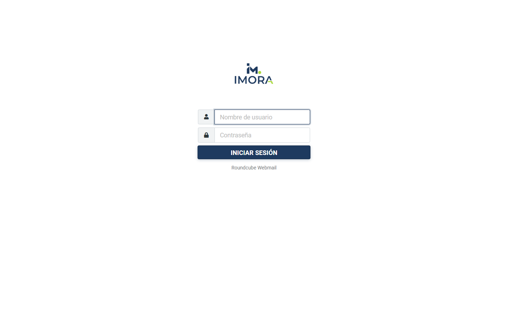
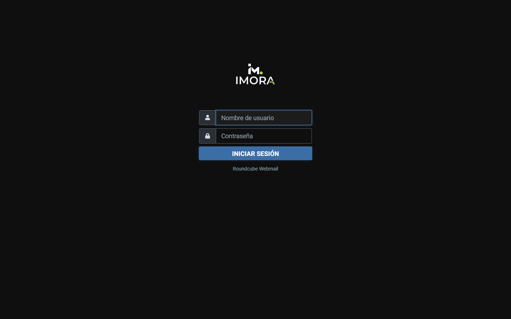
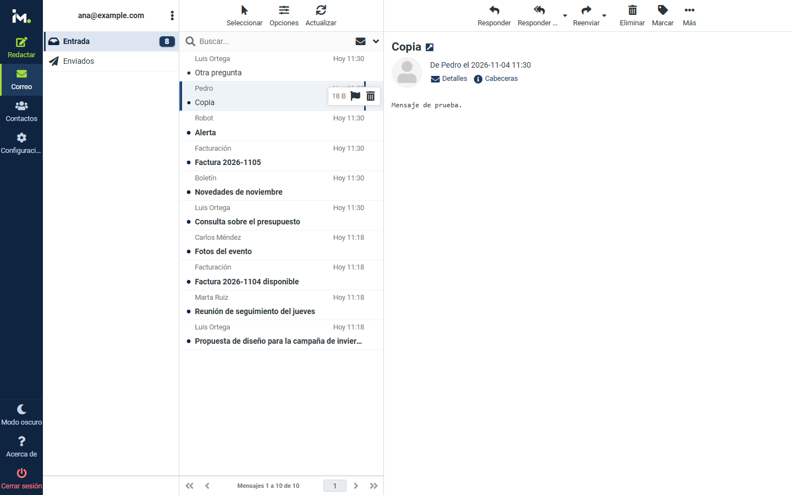
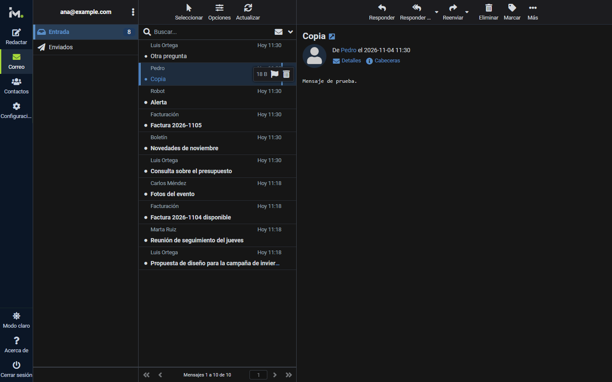
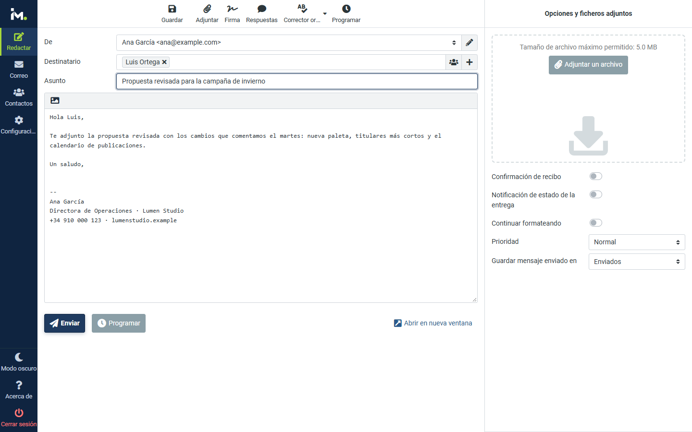
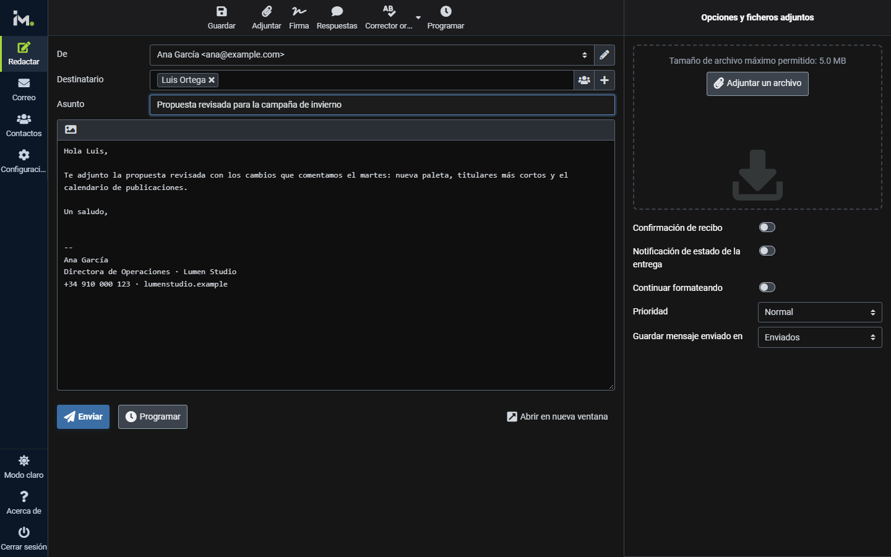
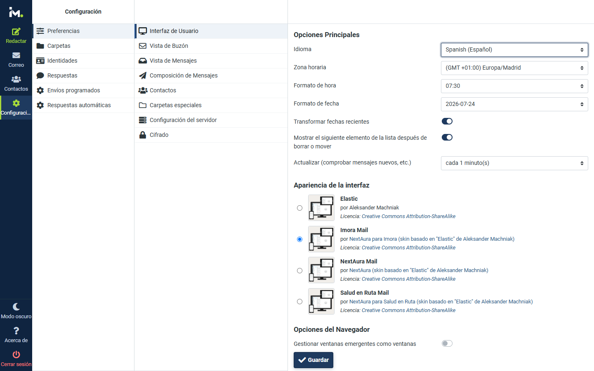
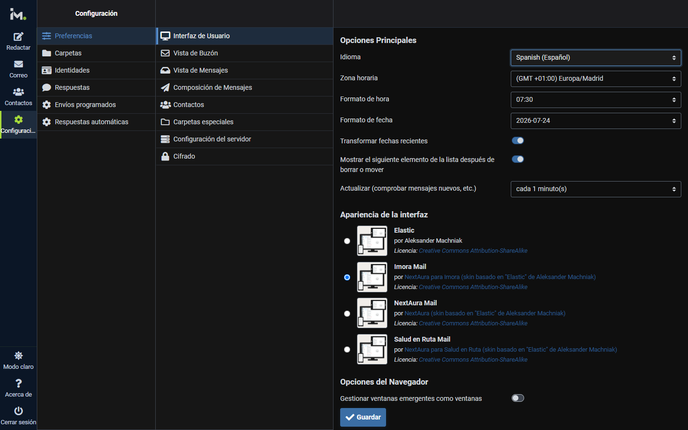

<div align="center">


# Imora Mail — Roundcube Skin

**Skin de Imora para Roundcube Webmail.**
Modo oscuro nativo, paleta de marca y logos propios, listo para producción.

[](http://creativecommons.org/licenses/by-sa/3.0/)
[](https://roundcube.net/)
[](https://github.com/roundcube/roundcubemail/tree/master/skins/elastic)

</div>

---

## Capturas de pantalla

| Modo claro | Modo oscuro |
|---|---|
|  |  |
|  |  |
|  |  |
|  |  |

Hechas con Roundcube 1.7.5 en Docker y correos de ejemplo.

---

## Características

- **Paleta de Imora**: azul marino `#1e3a5f` de la marca, acento lima `#a8d93a` del punto del logo y menú lateral en marino profundo.
- **Modo oscuro nativo** (`dark_mode_support: true`): fondos `#0f0f0f` / `#1c1c1f` y primario aclarado `#3b6ea5` para mantener el contraste.
- **Logos por modo**: logo completo claro/oscuro para el login y versión reducida para el menú lateral.
- **Sin gradientes**: diseño plano y limpio.
- **Scrollbars, foco y selección** con los colores de la marca en ambos modos.
- **Responsive**: escritorio, tableta y móvil (widescreen).
- **Hereda de Elastic** (`extends: elastic`), el skin oficial de Roundcube, a partir del tema de [NextAura](https://github.com/TheIsmael12/nextaura-roundcube). Plantillas y JavaScript siempre al día con tu Roundcube.

---

## Identidad de marca

| Rol                              | Color     | Vista |
|----------------------------------|-----------|-------|
| Primario (azul marino)           | `#1e3a5f` |  |
| Primario hover                   | `#2a4d78` |  |
| Primario active                  | `#0f2440` |  |
| Acento lima (punto del logo)     | `#a8d93a` |  |
| Acento suave                     | `#dde6f0` |  |
| Primario en modo oscuro          | `#3b6ea5` |  |
| Fondo oscuro                     | `#0f0f0f` |  |
| Superficie oscura                | `#1c1c1f` |  |

Toda la marca está en las variables `@br-*` al principio de `styles/_styles.less` y en las `@color-*` de `styles/colors.less`.

---

## Roundcube 1.7.5: hereda de Elastic

Desde esta versión el skin **hereda de Elastic** (`"extends": "elastic"` en `meta.json`), como recomienda la [guía de skins de Roundcube](https://github.com/roundcube/roundcubemail/wiki/Skins), en lugar de ser una copia completa.

- Las **plantillas, el JavaScript, las fuentes y los iconos** son los de Elastic de tu instalación, así que el skin recibe sus correcciones al actualizar Roundcube.
- El skin solo aporta la **paleta** (`styles/colors.less`), los **ajustes de marca** (`styles/_styles.less` y `styles/_dark.less`), los **logos** (con `skin_logo` en `meta.json`, sin tocar plantillas), el favicon, la marca de agua y `templates/includes/layout.html`, la única plantilla propia, que carga la hoja de estilos de la marca.
- Los estilos se compilan con los LESS de **Elastic 1.7.5**, y la CI comprueba que el CSS publicado está al día.
- Compatible con el plugin [Mail Scheduler](https://github.com/TheIsmael12/roundcube-mail-scheduler) (envíos programados y respuestas automáticas), que incluye estilos para este skin.

> Para Roundcube 1.6 usa la versión anterior del skin (commit `a19da9f`).

---

## Estructura

```
imora-roundcube/
├── meta.json                 # "extends": "elastic", logos (skin_logo) y modo oscuro
├── images/                   # Logos por modo y favicon
├── styles/
│   ├── colors.less           # ★ Paleta: solo lo que cambia respecto a Elastic
│   ├── _styles.less          # ★ Ajustes de marca (variables @br-*)
│   ├── _dark.less            # Ajustes del modo oscuro
│   ├── styles.less           # Entrada: Elastic + paleta + ajustes
│   ├── embed.less            # Contenido embebido (editor y mensajes)
│   └── *.min.css             # CSS compilado
├── templates/includes/
│   └── layout.html           # Carga styles.css de la marca (copia de la de Elastic 1.7.5)
├── bin/build.mjs             # Compilación de estilos
├── watermark.html            # Marca de agua del panel vacío
├── thumbnail.png
└── docs/capturas/
```

---

## Instalación

### 1. Copiar el skin

```bash
git clone https://github.com/TheIsmael12/imora-roundcube.git /var/www/roundcube/skins/imora
```

O con Composer:

```bash
composer require theismael12/imora
```

El skin necesita `skins/elastic`, que viene siempre con Roundcube.

### 2. Activar en Roundcube

```php
// config/config.inc.php
$config['skin'] = 'imora';
```

---

## Compilar estilos

Tras tocar `colors.less`, `_styles.less` o `_dark.less`, o al actualizar Roundcube:

```bash
cd /var/www/roundcube/skins/imora
npm install
npm run build        # usa ../elastic de la instalación
```

Fuera de una instalación de Roundcube:

```bash
ELASTIC_DIR=/ruta/a/roundcube/skins/elastic npm run build
npm run build -- --download   # descarga Elastic 1.7.5 de la release oficial
```

`npm run check -- --download` comprueba que el CSS publicado coincide con el que se generaría (es lo que ejecuta la CI).

---

## Créditos

Construido sobre el tema **Elastic** del equipo de Roundcube.

- Tema base: [Elastic Skin](https://github.com/roundcube/roundcubemail/tree/master/skins/elastic) — Aleksander Machniak
- Personalización de marca: [NextAura](https://nextaura.es) para Imora

| Librería         | Licencia   |
|------------------|------------|
| Bootstrap 4      | MIT        |
| FontAwesome 5    | CC BY 4.0  |
| Roboto (Google)  | Apache 2.0 |

---

## Licencia

**Creative Commons Attribution-ShareAlike 3.0**, heredada del skin Elastic.
Puedes copiar, distribuir, modificar y adaptar este trabajo siempre que mantengas los créditos al autor original (**Aleksander Machniak**) en este `README.md`.

[Ver licencia completa](http://creativecommons.org/licenses/by-sa/3.0/)
